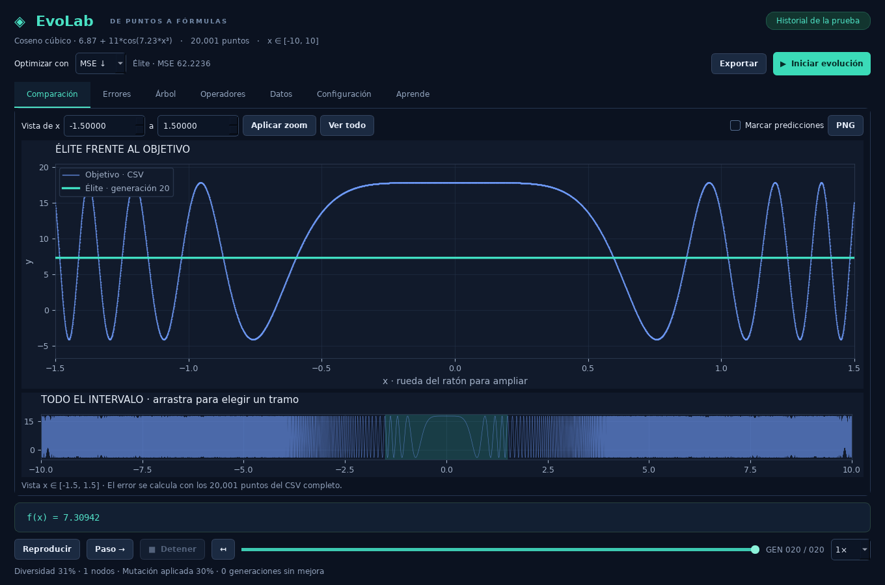

[↩ Volver a los algoritmos genéticos](../README.md)

# EvoLab · De puntos a fórmulas

Aplicación de escritorio en **Python, sin DEAP**, para visualizar programación
genética aplicada a regresión simbólica. Interfaz en español con PySide6,
gráficas Matplotlib y **motor escrito con Python estándar**. Los árboles,
las cuatro métricas, la selección, cruza, mutación, reparación, poda, CSV y
exportación no importan bibliotecas externas. NumPy solo prepara las gráficas.



## Ejecutar en Windows

Requiere Python 3.11 o posterior. Desde la carpeta del proyecto:

```powershell
python -m venv .venv
.\.venv\Scripts\python.exe -m pip install -r requirements.txt
.\.venv\Scripts\python.exe main.py
```

Si ya tienes instaladas las dependencias: `python main.py`.
También puedes hacer doble clic en `iniciar.bat`, que prefiere el entorno `.venv`.
No requiere servidor, navegador ni conexión a Internet después de instalar.

## Primera exploración

La aplicación inicia con **f(x) = 6.87 + 11 · cos(7.23 · x³)**, intervalo
**[-10, 10]**, ruido cero y **20 001 puntos**. El coseno usa radianes.
En Python la expresión es `6.87 + 11 * math.cos(7.23 * x**3)`:
`**3` eleva al cubo; `^` no es el operador de potencia de Python.
El CSV listo para importar está en `examples/coseno_cubico.csv`.

Se usan más puntos porque las oscilaciones se aceleran al alejarse de cero.
La interfaz inicia con profundidad máxima 7 para permitir representar el árbol
de esta fórmula usando multiplicaciones para x³. La búsqueda sigue comenzando
con árboles aleatorios y solo recibe los puntos; encontrar esta expresión exacta
es más difícil que encontrar la parábola. Puedes reducir los puntos para explorar
más rápido, aunque perderás detalle de las oscilaciones.

1. Abre **Datos**. Elige una función, intervalo, cantidad de puntos y ruido.
2. Pulsa **Generar** y **Guardar CSV**. También hay CSV listos en `examples/`.
3. Para demostrar la importación, pulsa **Importar CSV** y selecciona ese archivo.
4. Selecciona **Optimizar con: MSE, NMSE, R² o RMSE**. Ajusta los parámetros en **Configuración**.
5. Pulsa **Iniciar evolución**. La generación 0 muestra la población aleatoria.
6. Usa **Pausa**, **Paso →** o el deslizador para inspeccionar cada generación.
   En **Comparación** verás al élite del criterio seleccionado en verde y los puntos
   objetivo unidos en azul. Puedes activar **Marcar predicciones**.
   La rueda amplía alrededor del cursor; arrastrar en la vista general elige un tramo.
   **Ver todo** restaura el intervalo completo. El número de generación está en la leyenda.
7. En **Árbol**, inspecciona los ocho mejores candidatos de la generación.
8. En **Operadores**, elige un ejemplo real de cruza, mutación, reparación o poda.
9. En **Aprende**, consulta la teoría, pseudocódigo, métricas y una prueba de escritorio.
10. **Exportar** guarda datos, parámetros, predicciones e historial en un ZIP.

En **Errores** puedes consultar las cuatro métricas, cambiar la métrica mostrada
en el historial y comparar contra predecir el promedio. Cambiar esa vista no
recalcula la búsqueda. El selector superior elige el criterio de la próxima ejecución.
La gráfica principal empieza ampliada a [-1.5,1.5] para el coseno cúbico; su vista
general mantiene visible [-10,10]. **El zoom no cambia el conjunto de entrenamiento:**
las métricas usan todos los puntos y se conservan al recorrer el historial.

Durante una ejecución se bloquean los cambios de datos y parámetros. Pausar
detiene la solicitud de nuevas generaciones; una generación que ya está en cálculo
puede terminar. **Detener** conserva el historial y permite iniciar otra ejecución.
**Reproducir** recorre el historial; si el cálculo sigue activo, continúa al llegar
a la última generación disponible. La velocidad es un intervalo mínimo entre pasos,
no una promesa de rendimiento. El algoritmo no salta generaciones.

El CSV necesita encabezados `x,y`, punto decimal y al menos tres filas numéricas:

```csv
x,y
0,1
1,3
2,7
```

Se admite UTF-8 con BOM, encabezados con espacios/mayúsculas y separador `;`.
Se rechazan valores vacíos, NaN, infinito, más de 50 001 puntos, magnitudes mayores
de 1 000 000 y conjuntos donde todas las x sean iguales. Las filas se ordenan por x.
Las x repetidas son válidas si existe al menos otra x diferente.

## Primero entendamos el problema

Tenemos observaciones (x,y), pero no necesariamente conocemos la operación que
las produjo. Buscamos una fórmula f(x) que se acerque a ellas. No se le entrega
al motor la fórmula del generador: solo recibe los puntos y la configuración.

- **Entradas:** puntos x,y, población y parámetros evolutivos.
- **Proceso:** construir árboles, calcular predicciones, medir error y evolucionar.
- **Salidas:** fórmula y árbol, errores por generación, predicciones e historial.

Un algoritmo genético suele evolucionar listas de genes. Aquí el individuo es
un árbol cuyo tamaño y estructura cambian: esto es **programación genética**.
Cada hoja contiene x o una constante; cada nodo interno contiene una operación.

```text
       +             representa: (x * x) + 1
      / \
     *   1
    / \
   x   x
```

## Lógica y pseudocódigo

```text
crear población aleatoria de árboles (generación 0)
evaluar y mostrar
para generación = 1 hasta N:
    conservar al campeón del método de error elegido
    conservar las otras élites por aptitud penalizada
    reservar una fracción de la población para nuevos árboles aleatorios
    repetir hasta completar los puestos restantes:
        seleccionar padre A mediante torneo
        con probabilidad de cruza:
            seleccionar padre B e injertar una de sus ramas en A
        con probabilidad de mutación:
            reemplazar una rama o alterar una constante
        reparar estructura y limitar profundidad
        si la poda está activada: simplificar ramas redundantes
        agregar hijo
    agregar los árboles aleatorios reservados
    evaluar todos los árboles contra todos los puntos
    guardar generación y esperar el siguiente paso visual
```

Las probabilidades de cruza y mutación son independientes: un hijo puede recibir
ambas, una o ninguna. Se produce un hijo por cruza. Los padres y las generaciones
anteriores permanecen intactos porque `Node` es una clase inmutable.

**Selección por torneo:** se sortean k individuos sin reemplazo y gana quien tenga
menor aptitud. Se pueden repetir ganadores entre torneos distintos.

**Aptitud penalizada:** `pérdida / pérdida_del_promedio + penalización * nodos`.
La pérdida es la métrica elegida, excepto R², donde usamos `1-R²` para maximizarla.
Si la pérdida del promedio es cero, usamos 1 como escala. El campeón se elige por
el criterio sin penalización, con tamaño como desempate; se conserva por elitismo.
La penalización inicia en cero para priorizar el ajuste. Con valores positivos,
la escala elegida y la penalización pueden cambiar los compromisos entre ajuste y tamaño.
Si eliges una métrica indefinida, la aplicación explica el caso antes de iniciar;
MSE y RMSE siguen disponibles para datos constantes o todos iguales a cero.

**Inicialización:** mezcla árboles completos y árboles con hojas a distintas
profundidades. Constantes iniciales enteras y decimales entre −12 y 12.
La mutación de constantes usa perturbaciones gaussianas a escalas 0.00001, 0.001,
0.05, 0.5 o 2. Por defecto un 10% de cada nueva población son árboles aleatorios.
Tras 8 generaciones sin mejora, la mutación adaptativa opcional aumenta en 0.2
la probabilidad base hasta un máximo de 1. Estas ayudas exploran más posibilidades;
no garantizan recuperar una fórmula exacta ni inyectan la solución conocida.

**Ajuste opcional de escala y desplazamiento:** `refinement.py` estima dos
constantes en `a + b*g(x)`, manteniendo la forma encontrada por el algoritmo.
Esto permite aprovechar un árbol cuya forma es útil aunque todavía tenga una
amplitud o posición vertical incorrecta. Se usan únicamente los puntos del CSV:

```text
b = suma((g - promedio(g)) * (y - promedio(y))) / suma((g - promedio(g))²)
a = promedio(y) - b * promedio(g)
```

Es un ajuste de mínimos cuadrados implementado con Python estándar; no conoce
la fórmula objetivo. Se intenta en el 25% de los hijos y en los inmigrantes,
y se acepta solamente si el error real disminuye y el árbol respeta el límite
de profundidad. Aparece como **Ajuste de constantes** en Operadores. La opción
inicia activada; desactiva **Afinar escala y desplazamiento** en Configuración
para estudiar el algoritmo genético sin este ajuste adicional.

## Poda, reconstrucción y reparación

- **Poda algebraica:** `x + 0 → x`, `x * 1 → x`, operaciones entre constantes → constante.
- **Reconstrucción:** `replace()` crea un nuevo camino a la raíz al sustituir una rama.
- **Reparación:** `repair()` verifica operador, aridad (cantidad de hijos), constantes
  y profundidad. Al exceder el límite, sustituye la rama por una hoja aleatoria.
- **Aritmética protegida:** evita que las fórmulas aleatorias detengan la evaluación.

La reparación se aplica después de cruza y mutación; luego se aplica poda opcional.
La interfaz registra un ejemplo real por tipo de operador y generación, junto a
contadores globales de esa transición. Los ejemplos pueden ser hijos diferentes
y no necesariamente son los ancestros del campeón. El contador de reparaciones
cuenta correcciones y el de podas cuenta simplificaciones, no cantidad de individuos.
Reconstrucción tiene su propio ejemplo visual: muestra la reconstrucción que se
realiza al sustituir una rama en cruza o mutación, no un operador aleatorio adicional.
Su contador registra una reconstrucción por cada sustitución.
Es normal que alguna generación no necesite poda o reparación.

## Métricas usadas

Sea ŷ la predicción, ȳ el promedio observado y n la cantidad de puntos:

| Métrica | Definición | Mejor valor |
|---|---|---|
| MSE | Σ(y − ŷ)² / n | 0 |
| NMSE | Σ(y − ŷ)² / Σy² | 0 |
| R² | 1 − Σ(y − ŷ)² / Σ(y − ȳ)² | 1 |
| RMSE | √MSE | 0 |

Se usan las fórmulas de la fotografía de tus apuntes. La última métrica se llama
**RMSE**, raíz del error cuadrático medio. NMSE se normaliza por la suma de y²,
por lo que **R² no es 1 − NMSE** con esta definición.
Las fórmulas están centralizadas en `genetic_lab/metrics.py`.

### Una línea central y la elección de métrica

El promedio es la mejor **predicción constante** para el error cuadrático. Una
fórmula que siga bien las oscilaciones puede obtener un error menor. Por ejemplo:

| Observaciones y | Predicción | MSE | R² |
|---|---|---|---|
| [-1,1,-1,1] | [0,0,0,0] | 1 | 0 |
| [-1,1,-1,1] | [-1,1,-1,1] | 0 | 1 |

En un CSV fijo, MSE, NMSE y RMSE crecen con la misma suma de errores cuadrados;
R² disminuye al aumentar esa suma. **Las cuatro ordenan igual los candidatos**
(salvo redondeo numérico). Cambiar de métrica no elimina por sí solo la línea
central. La forma de mejorar es encontrar mejores candidatos: diversidad,
mutación, operadores adecuados y suficiente búsqueda. El historial incluye la
referencia del promedio para que se vea si el élite realmente la supera.

Cuando y es constante, R² es **N/D**. Cuando todos los valores y son cero,
NMSE también es **N/D**. MSE y RMSE siempre se calculan. R² puede ser negativo: significa que esa predicción
es peor que predecir siempre el promedio observado.

Todas las métricas se calculan sobre los datos de ajuste completos. No hay división
de entrenamiento/validación: un buen resultado no demuestra que la fórmula
generalice a puntos nuevos. El algoritmo es aleatorio y no garantiza encontrar
la fórmula original ni la expresión exacta. La misma semilla, datos y parámetros
permiten repetir una ejecución en el mismo entorno.

### Prueba de escritorio

Para x = [0,1,2], y = [1,2,5], y un candidato f(x)=x²:

| x | y | ŷ | residuo y−ŷ | residuo² |
|---|---|---|---|---|
| 0 | 1 | 0 | 1 | 1 |
| 1 | 2 | 1 | 1 | 1 |
| 2 | 5 | 4 | 1 | 1 |

MSE=1, Σy²=30, NMSE=3/30=0.1, varianza(y)=26/9,
R²=17/26≈0.65385 y RMSE=1. Con f(x)=x²+1, MSE=0.

## Interpretación de las expresiones protegidas

- `a / b`: si `abs(b) < 1e-9`, el divisor efectivo es 1 y el resultado es a.
- `sqrt(a)`: calcula `sqrt(abs(a))`.
- `log(a)`: calcula `ln(1 + abs(a))`.
- Cada operación limita su resultado a ±1 000 000; no se utiliza `eval()`.

Por tanto una fórmula exportada debe interpretarse con estas convenciones,
no copiarse como aritmética ordinaria fuera del dominio sin revisarlas.
La gráfica principal ajusta el eje y para incluir los datos objetivo y la curva
del élite en el intervalo visible. Si el élite está muy alejado,
la escala aumenta; al mejorar, permite observar con más detalle su aproximación.
Los círculos verdes vacíos opcionales muestran sus predicciones en las mismas x del CSV,
incluyendo al revisar generaciones anteriores, reproducir o avanzar paso a paso.

## Archivos y conceptos de Python

| Archivo | Responsabilidad | Conceptos que puedes estudiar |
|---|---|---|
| `main.py` | Arranca la aplicación | Importaciones y punto de entrada |
| `genetic_lab/trees.py` | Árboles y operaciones genéticas | Clases, tuplas, recursión, inmutabilidad |
| `genetic_lab/metrics.py` | Fórmulas de error | Ciclos, sumas, promedio y reutilización de denominadores |
| `genetic_lab/data.py` | CSV y generación de puntos | Archivos, validación y excepciones |
| `genetic_lab/evolution.py` | Ciclo evolutivo | Selección, azar, generadores con yield |
| `genetic_lab/refinement.py` | Ajuste opcional de constantes | Promedios, mínimos cuadrados y validación de una mejora |
| `genetic_lab/charts.py` | Gráficas y árboles visuales | Objetos gráficos y recorrido de árboles |
| `genetic_lab/app.py` | Interfaz y reproducción | Eventos, señales, hilos y tablas que cargan solo celdas visibles |
| `genetic_lab/exporting.py` | Exportar CSV, JSON y ZIP | Archivos y biblioteca estándar |
| `genetic_lab/guide.py` | Guía integrada | Presentación de contenido HTML |

`dataclass` genera métodos habituales de una clase a partir de sus atributos.
`frozen=True` impide reasignarlos. `yield` entrega una generación y pausa el
generador hasta la siguiente solicitud. `evaluate()` recorre el árbol y utiliza
listas de Python para aplicar cada operación a los puntos. `math` aporta seno,
coseno, raíz y sumas precisas; `random` genera el azar. Ambos vienen con Python.
Las señales Qt entregan el resultado desde el hilo de cálculo al hilo que dibuja;
un `threading.Event` concede permiso para calcular la siguiente generación.

## Exportación

El ZIP incluye `resultado.json` (configuración, fórmula y árbol de la generación
seleccionada), `datos.csv`, `predicciones.csv`, `generaciones.csv` e
`historial.json` (candidatos y ejemplos de operadores de todas las generaciones
calculadas). Las métricas indefinidas son `null` en JSON y `nan` en CSV.
No carga ni ejecuta código desde archivos. Puedes guardar la gráfica como PNG
desde Comparación. Los experimentos grandes generan archivos más grandes.

## Pruebas

```powershell
python -m unittest discover -s tests -v
```

Las pruebas comprueban métricas con un ejemplo calculado a mano, operadores
protegidos, poda, reconstrucción sin modificar padres, límites, lectura CSV,
reproducibilidad, elitismo, cancelación, paso a paso, historial y exportación.
También verifican la dirección de las métricas, casos indefinidos, conservación
del zoom y la ejecución del backend con `python -S`, que no carga paquetes de terceros.
Las pruebas de interfaz usan Qt en modo offscreen. Evaluar todos los puntos con
Python estándar requiere más tiempo que la versión vectorizada anterior; cada
generación puede tardar varios segundos y se calcula en el hilo de trabajo.

## Qué practicar después

1. Dibuja a mano el árbol de `(x + 2) * sin(x)` y cuenta sus nodos y niveles.
2. Compara mutación 0.05 frente a 0.50 manteniendo los demás parámetros.
3. Añade ruido y observa por qué un árbol enorme puede sobreajustar los datos.
4. Desactiva la poda y compara MSE y número de nodos.
5. Implementa un operador unario `neg` y sus pruebas antes de conectarlo a la interfaz.
6. Como siguiente mejora académica, añade un conjunto de validación separado.

**Prompt mejorado:** «Crea una aplicación de escritorio en Python sin DEAP para
regresión simbólica mediante programación genética. Debe importar/generar CSV x,y,
mostrar cada generación con pausa, paso a paso e historial, visualizar árboles y
ejemplos de cruza, mutación, poda y reparación. Usa selección por torneo y elitismo,
implementa MSE, NMSE=Σ(y−ŷ)²/Σy², R² y RMSE=√MSE. Incluye interfaz con pestañas,
exportación, pruebas y una guía para un estudiante principiante-intermedio». 

Referencias de integración: [Matplotlib en Qt](https://matplotlib.org/stable/gallery/user_interfaces/embedding_in_qt_sgskip.html)
y [QThread de PySide6](https://doc.qt.io/qtforpython-6/PySide6/QtCore/QThread.html).
